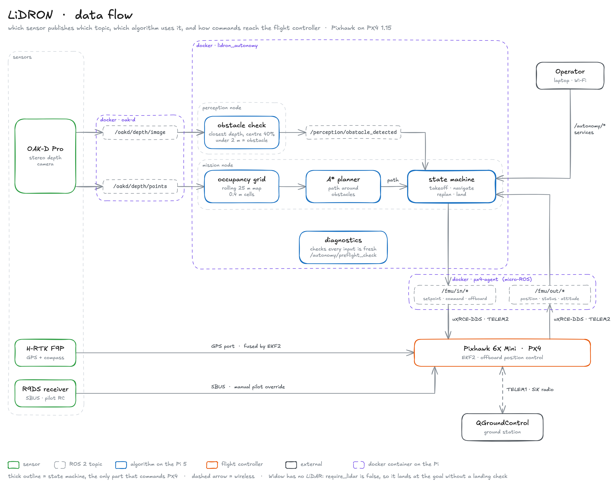
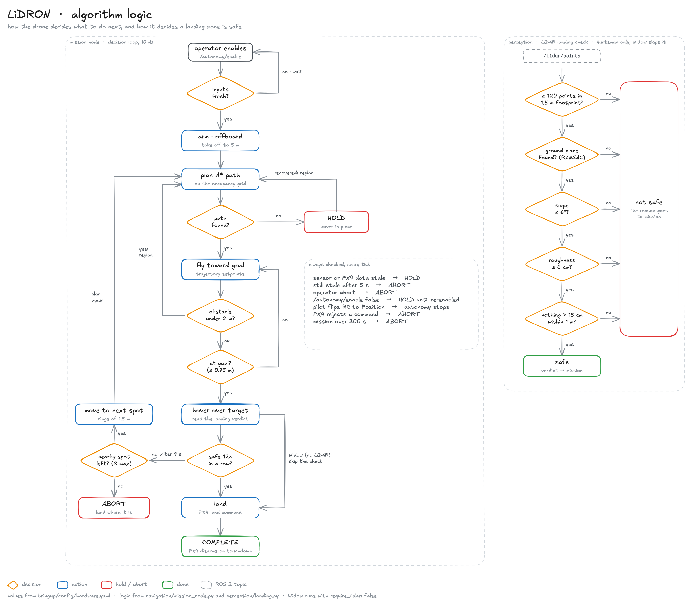

# LiDRON Autonomous Systems

This code flies the drone on its own. It maps obstacles with the OAK-D camera, plans a path with A*, sends the flight commands to PX4 and checks the landing spot with the LiDAR. The same container runs in simulation and on the drone's Raspberry Pi 5 (ROS 2 Jazzy, PX4 v1.15).

<picture>
  <source media="(prefers-color-scheme: dark)" srcset="docs/architecture/data-flow-dark.png">
  
</picture>

## Run it on the drone

1. Start the sensor containers from [Sensor-Control-Data-Gathering](https://github.com/LiDRON7/Sensor-Control-Data-Gathering).
2. Tell the Pi which drone it is, once: `echo DRONE=widow > integration/.env` (or `DRONE=huntsman`). It refuses to start without it.
3. Start autonomy:

   ```bash
   docker compose -f integration/compose.hardware.yml up -d --build
   ```

It loads `src/bringup/config/hardware.yaml`, then that drone's own numbers (`widow.yaml` or `huntsman.yaml`: camera position, LiDAR mount), and waits. Nothing flies until you start a mission. The first build on the Pi is slow because it compiles the PX4 messages.

`hardware.yaml` sets `require_lidar: false`, so the drone lands at the destination without checking the ground. Widow has no LiDAR, so it stays that way. For Huntsman, change it to `true` once the LiDAR is mounted and its cloud looks right in RViz.

## Run it in simulation

Clone [Simulation](https://github.com/LiDRON7/Simulation) next to this repo, then:

```bash
./scripts/simulation.sh up
```

`./scripts/sim_scenarios.sh` then flies every way a mission can end (A to B, around a tree, abort, pause, pilot takeover, a bad landing spot, crashes) and says PASS or FAIL; results are in the Simulation README. `./scripts/simulation.sh down` stops it. `DRONE=` in `Simulation/.env` picks the drone for both the simulator and the autonomy config. Machine setup (Linux, macOS, Windows) is in the Simulation README.

## Fly a mission

```bash
docker exec -it lidron_autonomy bash
source /autonomy/install/setup.bash
```

1. Check that every input is live. Only fly if it says `success: true`.
   `ros2 service call /autonomy/preflight_check std_srvs/srv/Trigger {}`
2. Set where to go, here 8 m north:
   `ros2 service call /autonomy/set_local_destination interfaces/srv/SetLocalDestination '{north: 8.0, east: 0.0, down: -5.0}'`
   The drone flies at `cruise_altitude_m` above where it took off. `down` (negative is up) only counts when it asks for more height than that, so a destination at ground level does not fly the drone into the ground.
3. Start:
   `ros2 service call /autonomy/enable std_srvs/srv/SetBool '{data: true}'`
4. Watch it:
   `ros2 topic echo /autonomy/state`
5. Stop and land if anything looks wrong:
   `ros2 service call /autonomy/abort std_srvs/srv/Trigger {}`

The pilot can take over at any time with the RC transmitter, or switch to Land, Hold or RTL in QGroundControl. Any mode change away from Offboard stops the autonomy, and so does a PX4 failsafe: it sends nothing more until the drone is disarmed and you start a new mission.

## How it decides

The drone takes off to 5 m and flies toward the goal. It replans when the camera sees something closer than 2 m. At the goal it checks the ground with the LiDAR. If the spot is unsafe it tries up to 8 nearby spots, and if none is safe it lands where it is. If any input goes stale it hovers, and after the hold timeout it aborts.

<picture>
  <source media="(prefers-color-scheme: dark)" srcset="docs/architecture/algorithm-logic-dark.png">
  
</picture>

## More

- [Connect to the Pi](https://github.com/LiDRON7/Sensor-Control-Data-Gathering/blob/flight-test/docs/connect-to-pi.md): how to SSH into the drone's Pi, at the university or in the field.
- [Pi setup](https://github.com/LiDRON7/Sensor-Control-Data-Gathering/blob/flight-test/docs/pi-setup.md): wire the drone's Pi, start the containers and check everything works.
- [Pi known issues](https://github.com/LiDRON7/Sensor-Control-Data-Gathering/blob/flight-test/docs/pi-known-issues.md): every problem we hit on the Pi, why, and the fix.
- [docs/topics.md](docs/topics.md): every topic and service, who sends it and who uses it.
- [docs/reference.md](docs/reference.md): parameters, tests and troubleshooting.
- `docs/architecture/`: the diagrams. Open the `.excalidraw` files at [excalidraw.com](https://excalidraw.com) to edit them.
