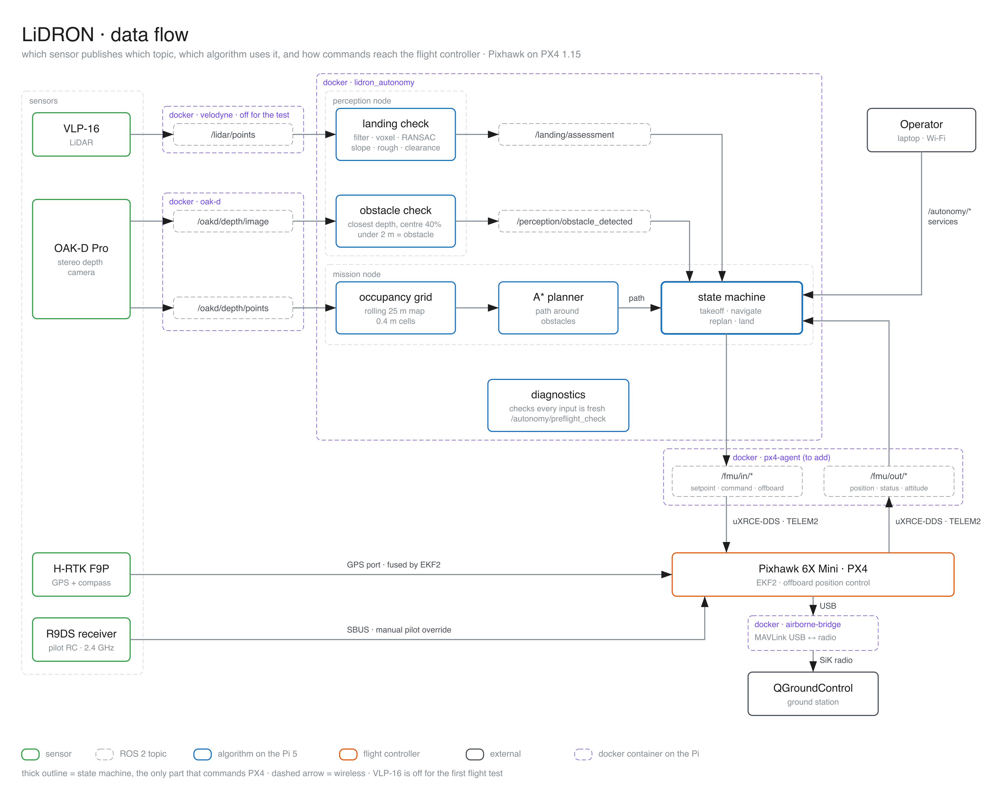

# LiDRON Autonomous Systems

The code that flies the drone by itself: it maps obstacles with the OAK-D camera, plans a path with A*, flies it through PX4 and checks the landing zone with the LiDAR.

ROS 2 Jazzy · PX4 v1.15 · Docker. The same container runs in simulation and on the drone's Raspberry Pi 5.



More diagrams: [connections](docs/architecture/lidron-2-connections.png) · [algorithm logic](docs/architecture/lidron-3-algorithm-logic.png). The `.excalidraw` sources are next to them.

## Run on the drone

Start the sensor containers first ([Sensor-Control-Data-Gathering](https://github.com/LiDRON7/Sensor-Control-Data-Gathering)). They provide PX4 (`/fmu/*`) and the camera (`/oakd/depth/*`).

```bash
docker compose -f integration/compose.hardware.yml up -d --build
```

This loads `src/bringup/config/hardware.yaml`. It never starts a mission by itself. The first build compiles the PX4 messages and takes a while on the Pi.

The flight-test drone has no LiDAR, so `hardware.yaml` sets `require_lidar: false`. The mission then skips the LiDAR checks and lands at the destination without a landing verdict. Set it to `true` once the LiDAR is mounted.

## Run in simulation

Clone [Simulation](https://github.com/LiDRON7/Simulation) next to this repository, then:

```bash
./scripts/simulation.sh up     # build and start Gazebo, PX4 SITL and autonomy
./scripts/simulation.sh down   # stop everything
```

Set `SIMULATION_ROOT=/path/to/Simulation` if the repositories are not side by side. Docker, display and VM setup for Linux, macOS and Windows is in the [Simulation README](https://github.com/LiDRON7/Simulation#readme).

## Fly a mission

Open a shell in the container:

```bash
docker exec -it lidron_autonomy bash
source /autonomy/install/setup.bash
```

Then:

1. Check every input is live. Do not fly unless it returns `success: true`.

   ```bash
   ros2 service call /autonomy/preflight_check std_srvs/srv/Trigger {}
   ```

2. Set a destination. This one is 8 m north at 5 m altitude (NED, so up is negative):

   ```bash
   ros2 service call /autonomy/set_local_destination interfaces/srv/SetLocalDestination '{north: 8.0, east: 0.0, down: -5.0}'
   ```

3. Start:

   ```bash
   ros2 service call /autonomy/enable std_srvs/srv/SetBool '{data: true}'
   ```

4. Watch the state:

   ```bash
   ros2 topic echo /autonomy/state
   ```

5. Abort if needed. This requests a controlled landing:

   ```bash
   ros2 service call /autonomy/abort std_srvs/srv/Trigger {}
   ```

The pilot can always take over with the RC transmitter, or switch to Land or RTL in QGroundControl.

## How it works

1. Preflight waits until PX4 and the camera (and the LiDAR, if required) are publishing.
2. The mission arms PX4, switches to offboard and takes off to 5 m.
3. Camera depth points build a rolling occupancy grid. A* plans a path to the destination.
4. The drone follows the path. A new obstacle under 2 m stops it and triggers a replan.
5. At the destination, the LiDAR landing check looks at area, slope, roughness and clearance. An unsafe spot makes it try up to 8 nearby spots, then abort. With `require_lidar: false` it lands straight away.
6. The mission is `COMPLETE` when PX4 disarms after touchdown.

States: `IDLE → PREFLIGHT → TAKEOFF → PLANNING → NAVIGATING → APPROACH → LANDING_CHECK → LANDING → COMPLETE`, plus `REPLANNING`, `HOLD` and `ABORT`. Stale data puts the drone in `HOLD`. Still stale after the hold timeout means `ABORT`.

## Topics and services

| Package | Reads | Publishes |
| --- | --- | --- |
| `perception` | `/oakd/depth/image`, `/lidar/points` | `/perception/obstacle_detected`, `/perception/obstacle_distance`, `/landing/assessment`, `/landing/ground_points`, `/landing/non_ground_points` |
| `navigation` (mission) | `/oakd/depth/points`, `/perception/obstacle_detected`, `/landing/assessment`, `/fmu/out/vehicle_local_position`, `vehicle_attitude`, `vehicle_status`, `vehicle_command_ack` | `/fmu/in/offboard_control_mode`, `trajectory_setpoint`, `vehicle_command`, `/autonomy/state`, `/autonomy/path`, `/autonomy/occupancy_grid` |
| `navigation` (diagnostics) | camera, LiDAR, `/fmu/out/vehicle_local_position`, `vehicle_status`, `vehicle_gps_position` | `/autonomy/preflight_check` service |

The mission node is the only thing that commands PX4.

| Service | Type | Does |
| --- | --- | --- |
| `/autonomy/set_local_destination` | `interfaces/srv/SetLocalDestination` | Set a north/east/down destination |
| `/autonomy/set_gps_destination` | `interfaces/srv/SetGpsDestination` | Set a latitude/longitude/altitude destination |
| `/autonomy/enable` | `std_srvs/srv/SetBool` | Start (`true`) or hold (`false`) |
| `/autonomy/abort` | `std_srvs/srv/Trigger` | Controlled landing |
| `/autonomy/preflight_check` | `std_srvs/srv/Trigger` | Check every input is live |

## Configuration

| File | Used by |
| --- | --- |
| `src/bringup/config/simulation.yaml` | `./scripts/simulation.sh` |
| `src/bringup/config/hardware.yaml` | `integration/compose.hardware.yml` |

The container picks the file from `AUTONOMY_CONFIG` (`simulation` or `hardware`). Restart it after changing parameters: `docker restart lidron_autonomy`.

LiDAR filters, all in meters and in the LiDAR frame:

| Parameter | Default | Meaning |
| --- | --- | --- |
| `roi.x_min`, `roi.x_max`, `roi.y_min`, `roi.y_max` | `±10.0` | Keep only points inside this box. It must contain the landing footprint and clearance area. |
| `roi.z_enabled`, `roi.z_min`, `roi.z_max` | `false`, `±10.0` | Z crop. Off until the sensor orientation and flight height are checked. |
| `filters.voxel_size_m` | `0.03` | Downsampling |
| `ransac.dist_threshold` | `0.2` | Max distance from the ground plane for an inlier. Separate from the roughness limit. |
| `ransac.num_iterations` | `100` | Plane candidates (fixed seed, so results repeat) |

`landing.min_points` is also the minimum RANSAC inlier count. A small footprint returns `insufficient_ground_points`; no plane returns `ground_plane_not_found`. To see the segmentation in RViz, add PointCloud2 displays for `/landing/ground_points` and `/landing/non_ground_points` with the LiDAR frame as Fixed Frame.

## Tests

With the container running:

```bash
docker exec lidron_autonomy bash -c "
  source /opt/ros/jazzy/setup.bash && source /opt/px4_ws/install/setup.bash &&
  cd /autonomy && colcon build --symlink-install && source install/setup.bash &&
  colcon test --packages-select perception navigation && colcon test-result --verbose
"
```

The navigation tests also run without ROS, with only numpy and pytest: `cd src/navigation && python -m pytest test`.

## Troubleshooting

| Problem | Check |
| --- | --- |
| Container stopped | `docker logs lidron_autonomy` |
| No `/fmu` topics | Sim: `docker logs lidron_dds_agent`. Drone: `docker logs px4-agent`, the TELEM2 wiring and the PX4 `UXRCE_DDS_CFG` parameter. Then `ros2 topic list \| grep fmu`. |
| No camera topics | `docker logs oak-d` and `ros2 topic list \| grep oakd` |
| Topics listed but no data | Every container needs `network_mode: host`, `ipc: host` and the same `ROS_DOMAIN_ID`. |
| Simulation not found | `export SIMULATION_ROOT=/path/to/Simulation && ./scripts/simulation.sh check` |
| Rebuild the image | `docker build -f integration/Dockerfile -t lidron-autonomy:jazzy-px4-1.15 .` |
