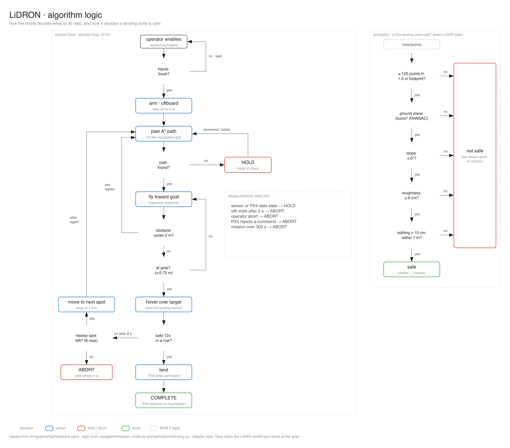
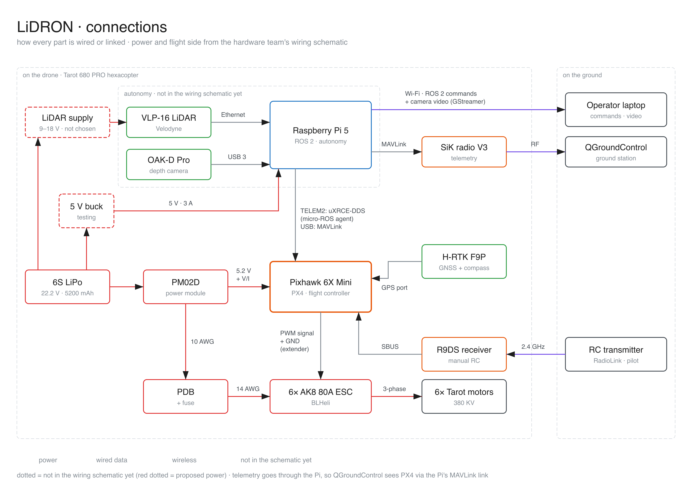

# LiDRON Autonomous Systems

This code flies the drone on its own. It maps obstacles with the OAK-D camera, plans a path with A*, sends the flight commands to PX4 and checks the landing spot with the LiDAR. The same container runs in simulation and on the drone's Raspberry Pi 5 (ROS 2 Jazzy, PX4 v1.15).


## Run it on the drone

1. Start the sensor containers from [Sensor-Control-Data-Gathering](https://github.com/LiDRON7/Sensor-Control-Data-Gathering).
2. Start autonomy:

   ```bash
   docker compose -f integration/compose.hardware.yml up -d --build
   ```

It loads `src/bringup/config/hardware.yaml` and waits. Nothing flies until you start a mission. The first build on the Pi is slow because it compiles the PX4 messages.

The flight-test drone has no LiDAR yet, so `hardware.yaml` sets `require_lidar: false`. In that mode the drone lands at the destination without checking the ground. Change it to `true` once the LiDAR is mounted.

## Run it in simulation

Clone [Simulation](https://github.com/LiDRON7/Simulation) next to this repo, then:

```bash
./scripts/simulation.sh up
```

`./scripts/simulation.sh down` stops it. Machine setup (Linux, macOS, Windows) is in the Simulation README.

## Fly a mission

```bash
docker exec -it lidron_autonomy bash
source /autonomy/install/setup.bash
```

1. Check that every input is live. Only fly if it says `success: true`.
   `ros2 service call /autonomy/preflight_check std_srvs/srv/Trigger {}`
2. Set where to go, here 8 m north at 5 m up (down is negative):
   `ros2 service call /autonomy/set_local_destination interfaces/srv/SetLocalDestination '{north: 8.0, east: 0.0, down: -5.0}'`
3. Start:
   `ros2 service call /autonomy/enable std_srvs/srv/SetBool '{data: true}'`
4. Watch it:
   `ros2 topic echo /autonomy/state`
5. Stop and land if anything looks wrong:
   `ros2 service call /autonomy/abort std_srvs/srv/Trigger {}`

The pilot can take over at any time with the RC transmitter, or switch to Land or RTL in QGroundControl.

## How it decides

The drone takes off to 5 m and flies toward the goal. It replans when the camera sees something closer than 2 m. At the goal it checks the ground with the LiDAR. If the spot is unsafe it tries up to 8 nearby spots, and if none is safe it lands where it is. If any input goes stale it hovers, and after the hold timeout it aborts.



## How it is wired



To edit a diagram, open its `.excalidraw` file in `docs/architecture/` at [excalidraw.com](https://excalidraw.com).

## Reference

Topics, services, parameters, tests and troubleshooting are in [docs/reference.md](docs/reference.md).
